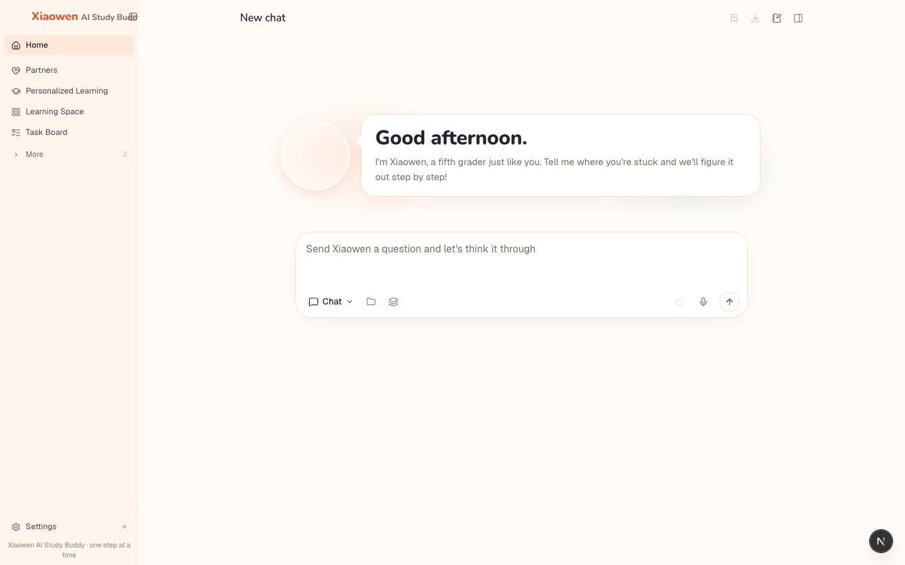
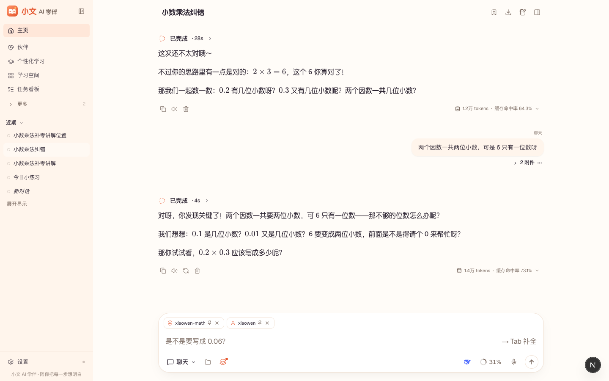
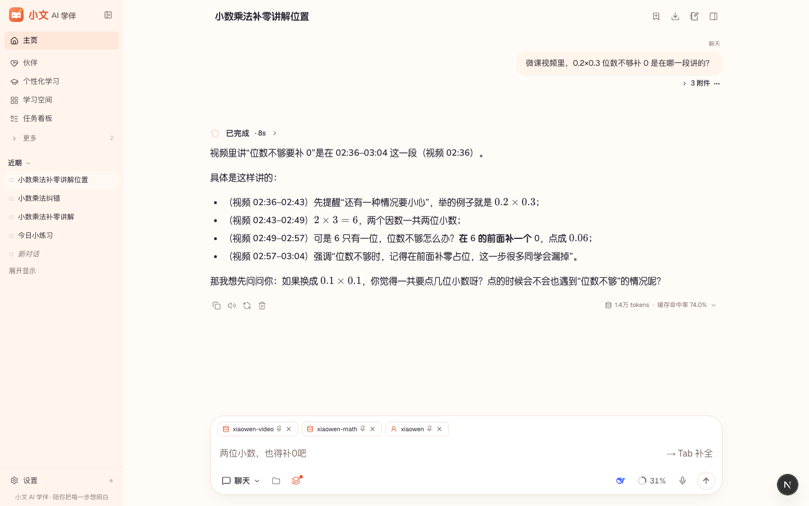
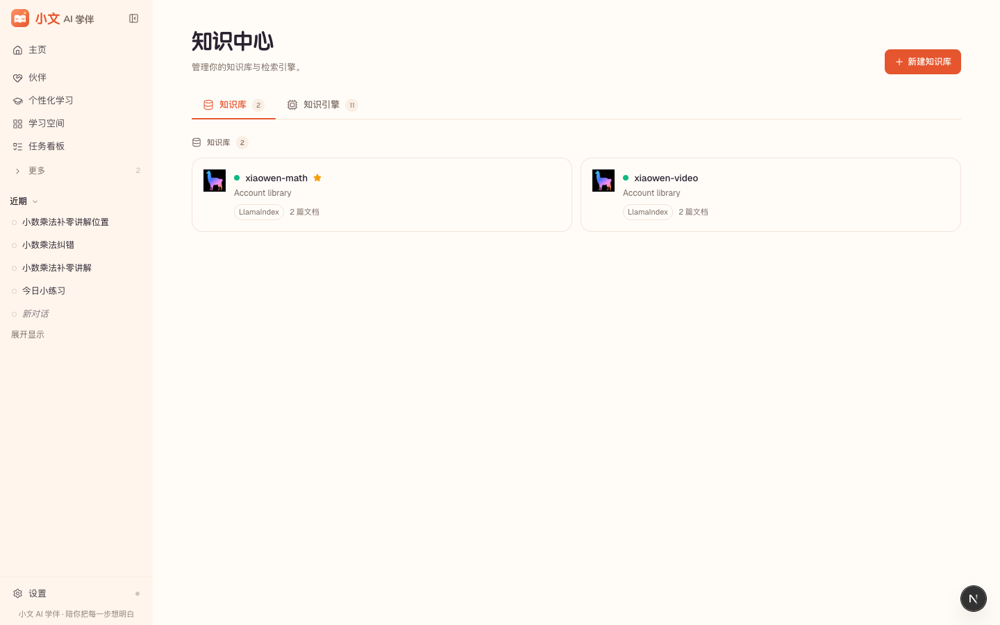

<p align="center"></p>

<h1 align="center">小文 AI 学伴</h1>

<p align="center">陪小学生一步步想明白的 AI 学伴 · 同龄女学生 · 苏格拉底式引导 · 不直接给答案</p>

<p align="center"><em>Derived from <a href="https://github.com/HKUDS/DeepTutor">DeepTutor</a> (Apache-2.0, HKUDS)</em></p>

---

## 项目介绍

小文 AI 学伴是一个面向 K12 的 AI 学习伙伴，第一版聚焦 **小学数学 · 五年级上册 · 小数乘法**。

学伴「小文」被设定为和学生同龄的女同学：语气温柔、会鼓励人，用一次一个问题的苏格拉底式追问，引导学生自己想出答案，而不是直接给出结果。所有讲解以本地知识点和题库为准，视频微课的问答会标注字幕时间点。

本项目基于开源框架 DeepTutor 做二次开发：对话引擎、知识库检索、会话与记忆等能力来自 DeepTutor；品牌视觉、学伴人格、K12 教学内容、视频字幕问答链路为本项目原创。

## 功能与演示

| 能力 | 说明 |
| --- | --- |
| 苏格拉底式答疑 | 问 `2.5×0.4`，先引导“把小数点盖住算 25×4”，不直接报答案 |
| 错因引导 | 答 `0.2×0.3=0.6`，判“还不太对”，引导数小数位数、在 6 前面补 0 得 `0.06` |
| 题库出题与判题 | 从本地题库出题并注明题号（如 T12），学生作答后只判对错 + 一句追问 |
| 视频字幕问答 | 问“补 0 在哪段讲的”，回答“视频 02:36–03:04”，逐条对应字幕 |
| 原创白牌界面 | 暖阳珊瑚主题、原创 Logo 与学伴头像、学伴口吻的欢迎页与加载态 |

<p align="center">
  
  
</p>
<p align="center">
  
  
</p>

## 技术栈

- 后端：Python 3.11+、FastAPI、DeepTutor 能力运行时（chat capability + Persona + RAG）
- 前端：Next.js 16、React、Tailwind CSS、i18next（中文为默认语言）
- 检索：LlamaIndex 知识库引擎
- 模型：DeepSeek `deepseek-chat`（对话）、硅基流动 `BAAI/bge-m3`（1024 维向量）

## 架构简图

```
学生（Web 界面 · 小文白牌）
        │
        ▼
Next.js 前端 ──/api, /ws──▶ FastAPI 后端
                               │
                               ▼
                    TurnEngine → chat capability
                     │          │            │
              Persona「小文」  RAG 检索      DeepSeek LLM
              （人格与陪学规则）  │
                         ┌──────┴───────┐
                  xiaowen-math     xiaowen-video
                 知识点 + 30 题库   字幕时间轴 + 讲稿
```

## 运行步骤

```bash
# 1. 后端（可编辑安装）
python3 -m venv .venv && source .venv/bin/activate
pip install -e ".[server]"

# 2. 前端依赖（推荐 Node 22）
(cd web && npm ci --legacy-peer-deps)

# 3. 启动（前端 http://localhost:3782，后端 http://127.0.0.1:8001）
deeptutor start --dev
```

4. 打开 **设置 → 模型与服务**：在「提供方」添加 DeepSeek（`https://api.deepseek.com/v1`）和硅基流动（`https://api.siliconflow.cn/v1`）并填入各自的 Key；在「语言模型」选 `deepseek-chat`，在「嵌入模型」选 `BAAI/bge-m3`（维度 1024）。Key 只保存在本地私有设置里，不会进入仓库。
5. 自检：`deeptutor doctor --online`
6. 建知识库：

```bash
deeptutor kb create xiaowen-math \
  --doc k12-content/数学知识点-小数乘法.md --doc k12-content/数学题库-小数乘法.md
python scripts/k12/srt_to_md.py k12-content/示例视频-小数乘法微课.srt \
  k12-content/generated/示例视频-小数乘法微课-字幕时间轴.md --title 小数乘法微课
deeptutor kb create xiaowen-video \
  --doc k12-content/generated/示例视频-小数乘法微课-字幕时间轴.md \
  --doc k12-content/示例视频-小数乘法微课-讲稿.md
```

7. 在对话输入框下方选择人格 `xiaowen`，挂上知识库 `xiaowen-math`（视频问答再加 `xiaowen-video`）即可开始。
8. 复跑验收对话：`python scripts/k12/xiaowen_acceptance.py`

## 目录

```
web/public/brand/          品牌资源（Logo、学伴头像、favicon）—— 替换即换皮
web/app/brand.css          品牌主题色与样式
web/lib/brand.ts           品牌常量；web/components/brand/ 品牌组件
web/locales/*/app.json     界面文案（brand.* 键为品牌文案）
deeptutor/services/persona/presets/xiaowen/   小文 Persona
deeptutor/skills/builtin/xiaowen-math/        小文 Skill
k12-content/               原创教学内容（知识点、题库、微课字幕与讲稿）
k12-docs/                  视频字幕问答的缺口分析与最小插件方案
scripts/k12/               SRT 转换、验收对话、演示会话脚本
screenshots/               界面截图
```

## 个人贡献

- **产品定义**：学伴人设（同龄女学生）、陪学铁律（不给答案、一次一问、先判对错再引导）、第一版范围（五上·小数乘法）。
- **原创白牌**：主题色体系、Logo、学伴头像、欢迎页 / 加载态 / 登录页 / 页脚，全语种文案改为小文品牌，品牌资源集中便于一键替换。
- **学伴落地**：小文 Persona 与 Skill、对话身份提示词、知识点与题库知识库、出题判题与题库引用规则。
- **视频字幕问答**：SRT → 带时间点字幕库的转换链路，回答强制标注并只引用真实时间点；梳理原生能力与缺口，给出最小插件方案。
- **质量保障**：真实模型多轮验收脚本，前端 typecheck / i18n / build 与相关后端测试全部通过。

## 如何替换内容

- 题库 / 知识点：替换 `k12-content/` 中的 Markdown，`deeptutor kb add xiaowen-math --doc 新文件.md`（或删库重建）。
- 视频：有真实视频时，在「阅读」里上传 mp4 或添加 B 站 / YouTube 链接，并在 设置 → 语音 配置转写模型，即可使用原生的播放与时间点跳转；只有字幕时用 `scripts/k12/srt_to_md.py` 转换后加入 `xiaowen-video`。
- 品牌：替换 `web/public/brand/*`，修改 `web/app/brand.css` 顶部 `--brand-*` 变量与 `locales` 中的 `brand.*` 文案。

## 致谢与许可

本项目 Derived from [DeepTutor](https://github.com/HKUDS/DeepTutor)（Apache-2.0，© HKUDS），在其基础上进行二次开发，原项目说明见 [UPSTREAM_README.md](UPSTREAM_README.md)。

遵循 Apache License 2.0，见 [LICENSE](LICENSE) 与 [THIRD_PARTY_NOTICES.md](THIRD_PARTY_NOTICES.md)。本项目中的品牌名称、视觉素材与 K12 教学内容为原创。
